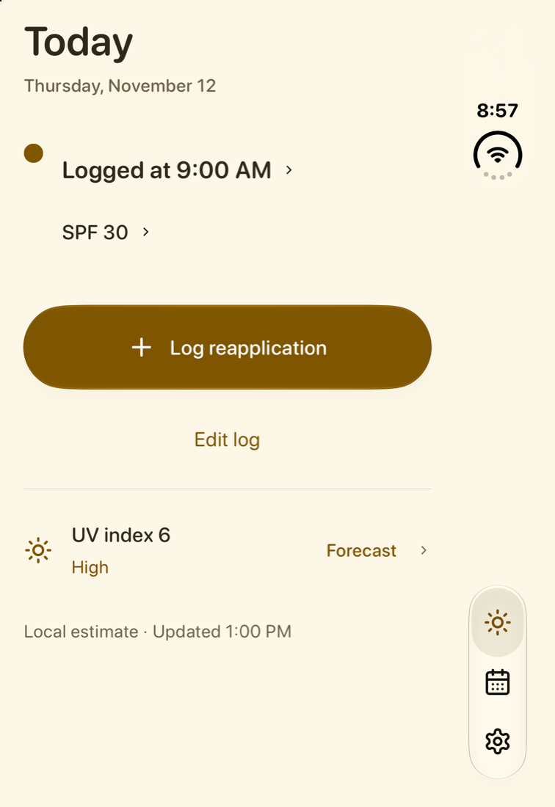
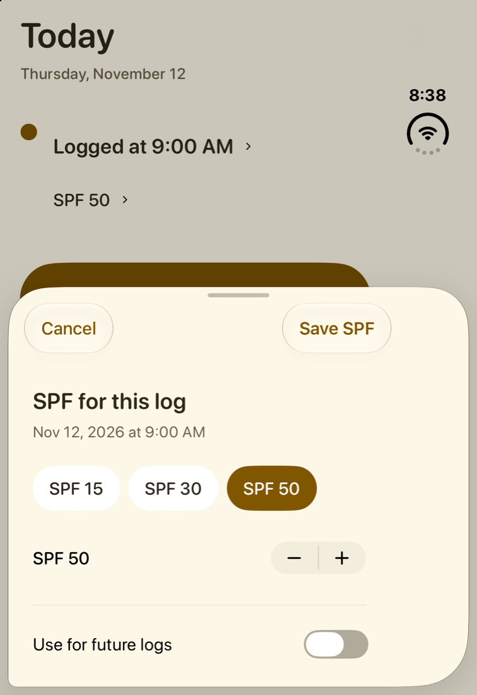
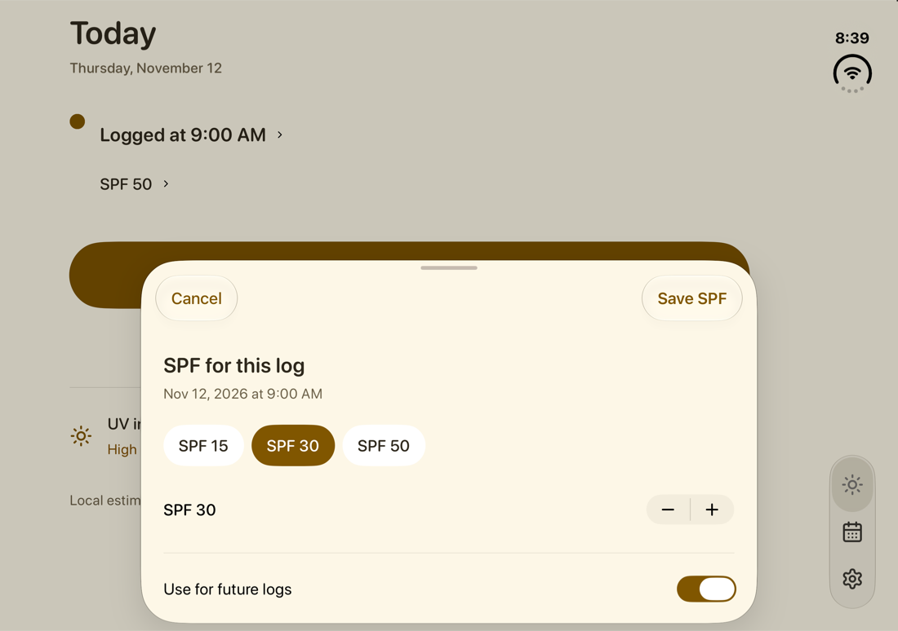
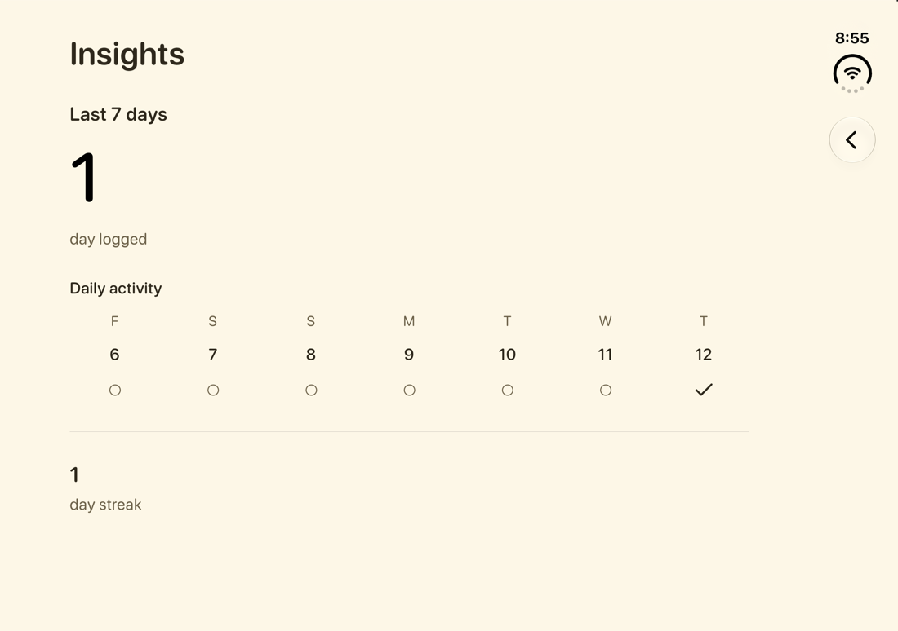
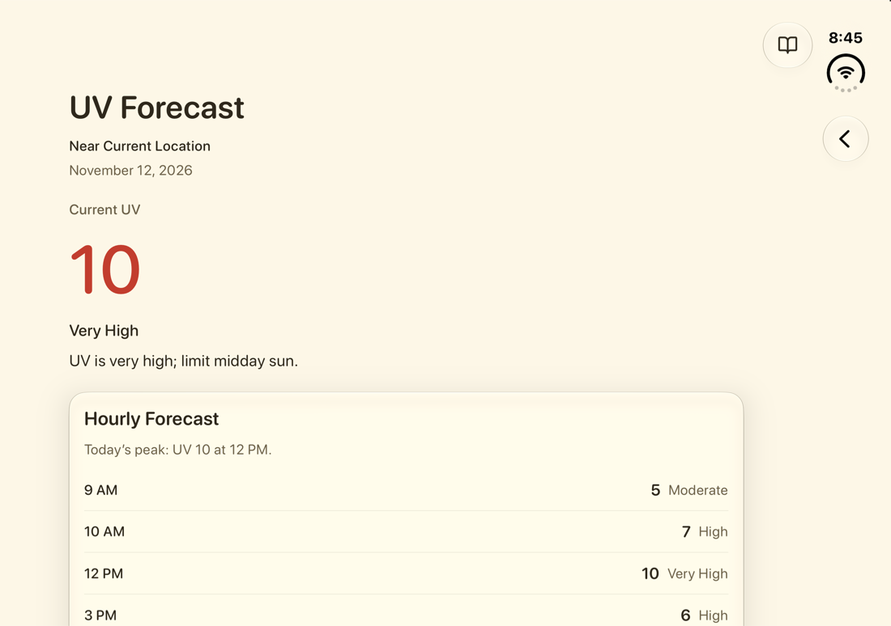
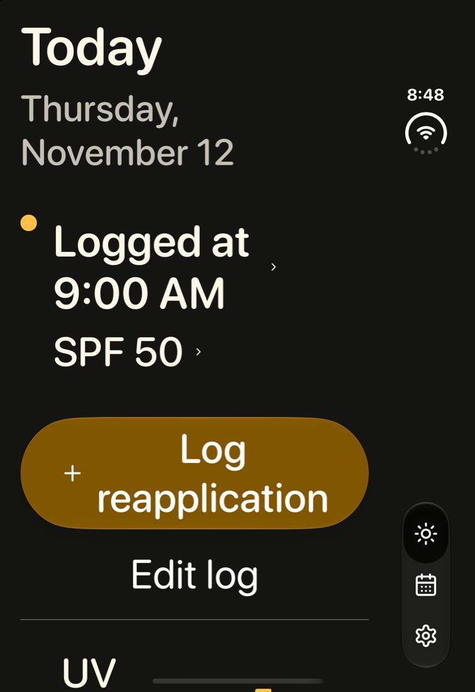

# Duo usability audit — November 12, 2026

Sunclub should make recording sunscreen quick and obvious. This audit keeps the
existing cream-and-amber design and features, reduces repeated information, and
checks spacing on closed, partially open, and open iPhone Duo layouts.

The development app was built with Xcode 27.2 (27B52). Final Duo captures use the
iOS 27.2 simulator runtime 24B91016s and deterministic test data. Working notes
and the complete capture set are in `.build/duo-audit/`; the selected evidence
below is tracked with this report. Blank or partially rendered startup captures
were rejected and recaptured after the interface settled.

## Journey and findings

1. **Onboarding — clear.** Welcome has one prominent Get Started action.
   Reminders are optional, and Not now allows setup to finish without permission.
2. **Today, empty and logged — simpler.** Logging remains one tap. The primary
   action becomes Log reapplication after the first application; Undo, Edit log,
   and SPF editing remain available. Removing the redundant Now row eliminates
   repeated clock information and its extra gap. UV context follows the logging
   action, with source information and forecast access.
3. **SPF editing — corrected.** Save previously fell below the default sheet
   fold, and unfolding reset an unsaved SPF selection. Native Cancel and Save
   actions keep saving visible. The presenter now retains the draft: SPF 30 and
   Use for future logs survived closed → partially open → open, then saved after
   refolding without changing the application time. The regression exercises
   the native Save action at both vertical edges of a 44-point touch target;
   its visual accessibility frame is smaller than its hit region. Save failures
   use a native alert so feedback cannot fall below the visible sheet.
4. **History and Insights — readable.** History retains direct day selection,
   editing, deletion, and access to the full calendar. The single-day summary
   uses singular “day.” Insights retains counts, streaks, and seven explicit
   logged/not-logged states. Removing duplicate bars and bounding the content
   width makes the open layout easier to scan.
5. **Manual logging and Forecast — focused.** The manual editor keeps its
   primary Save action visible, with optional details collapsed. Forecast keeps
   current UV, peak information, and hourly values; its duplicate bar chart was
   removed after the open layout exposed an unnecessarily sparse chart card.
6. **Settings and secondary screens — usable.** Reviewed Sunscreen, Reminders,
   Weather, Health, Backup, Recovery, Automation, Privacy, and Support. Grouped
   settings keep daily preferences easy to find. Reminder interval controls now
   have minimum 44-point targets.
7. **Large text and adaptive layouts — checked with limits.** Closed and open
   layouts retain readable controls without overlapping navigation. The SPF
   sheet was also checked with the simulator's actual Accessibility Extra Large
   Dynamic Type setting because the test override did not reliably propagate
   into presented sheets.

Unused lower screen space on short forms is purposeful: content stays together
and primary actions remain easy to find. It does not need extra cards,
illustrations, or generated artwork. The removed duplicate rows and charts
address accidental gaps without adding steps.

## Selected visual evidence

Today keeps logging prominent on the closed display.

SPF editing keeps the draft and save action available across the fold.

Insights and Forecast present each fact once in bounded content.

The closed Today layout was also inspected at an accessibility text size.

## Verification status

- 660 unit tests passed on Xcode 27.2 before the final chart and copy
  simplifications. An earlier Duo unit launch failed before tests
  started and is not counted as passing evidence.
- 15 Duo smoke tests, two focused timeline tests, three focused forecast tests,
  and three focused SPF tests passed. The Save edge taps both saved correctly.
- Repository lint and 288 Python tests passed.
- Hosted CI on the final commit is the release gate; these local results do not
  establish that the final candidate has passed every check.
- Screenshots support visual review, not physical-device certification or full
  accessibility compliance. They do not establish VoiceOver behavior, and the
  simulator fold checks do not replace testing on physical Duo hardware.
